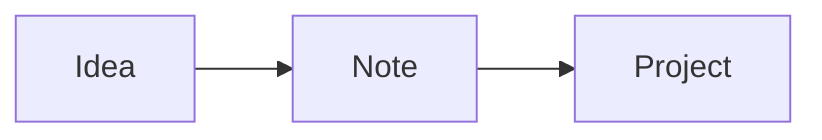

The app's design system: the primitives that arrange a page and every piece of Markdown it draws, drawn live on your data. Pages are made by putting these together with blocks. A block is a fence, ```` ```block-<name> ````, with its options inside as YAML; each plugin declares its own (`vau blocks` lists them, with their options). Switch to editing (⌘E) to see how each one is written, and copy it into any file.

## Layout

The primitives that arrange a page, and the options every block takes.

| Primitive | How |
| --- | --- |
| Grid | A dashboard (`type: dashboard`, drawn by the Dashboards plugin) lays its blocks out in two columns; one in a narrow pane or on a phone; with Dashboards off, one under another like any file |
| Editing | A dashboard edits as it reads: the same grid, its text typed in place between the blocks; a card's bar (on hover, always on a phone) drags it elsewhere, sets Full width and Under the one before, shows its source (`</>`) and removes it; Add a block puts one in. Source mode is the file's Markdown |
| `wide: true` | The block takes the whole row |
| `stack: true` | The block goes under the one before it, in the same column |
| ```` ```tasks wide ```` | A fence a plugin draws (```` ```tasks ````, ```` ```base ````) keeps `wide` and `stack` after its language, as its text is the plugin's own |
| `file: <name>` | Any block, drawn for another file: a name or path like a `[[link]]`, or a folder ending in `/` for its newest file |
| Options | Each block's own are declared by its plugin (`vau blocks <name>`); typing in a block suggests them. One it doesn't take, or of the wrong type, gets a quiet line under the block while editing, and the block is drawn anyway |
| Markdown | Any text between blocks takes a row of its own, like this one |
| Embeds | `![[Spending.html]]` or `![[Transactions.csv]]` on a line of its own: an interactive page or a table (`\|400`: its height); a PDF, audio, video, or a file a plugin draws (`![[Board.canvas]]`: a canvas of cards and arrows) the same way; a note (`![[Note]]`, a section `![[Note#Heading]]`, a block `![[Note#^id]]`) is its text |
| Frontmatter | `icon` (a lucide name, drawn before the title), `tint` (a colour token), `plugin` (hidden while it's off) |
| Archived | "Archive" in a file's menu: moved into `.archive/` in its folder with `archived: true` (hidden in the file tree until "Show archived files", then dimmed), left out of the sidebar, lists, the graph and database views (a base's `archived: true` adds them), last in search |

Right-click any block (hold a finger on it on a phone) for where its data comes from: the files it shows (a click opens one), its plugin's settings and cache, and what's live; then Options (a form) and Edit source. In the editor a block stays drawn when clicked: hover for its bar, whose </> shows its Markdown.

Every block shows the same states, drawn by the app: "Loading…" while its data comes (shimmering, after a moment so a fast load just appears; a list draws skeleton rows instead, as many as it had last time, so nothing jumps when the data comes), a line in its place if it can't be drawn (the rest of the page stays), and, outside a dashboard, a line saying its plugin is off (a dashboard being read leaves it out).

Toasts are the one thing the app draws outside pages: a short line at the bottom of the window that goes away by itself, with one button at most ("Moved to Notes · Undo"; an error has a red icon). A plugin shows one with `notify(text)`, an agent with `vau notify "text"`.

## Markdown

Text is **bold**, *italic*, ~~struck~~, `code`, a [link](https://example.com), or a [[ME|wikilink]] to any file (grey when nothing has that name yet). A Markdown link goes anywhere too: a note (`[x](Note)`), a file (`[pdf](files/a.pdf)`) or another app (`obsidian://`, `zotero://`, `tel:`). When several files have a name, the closest to the linking file wins; a link to nothing that looks like another name ("Alice" for Alice Park) asks "Did you mean".

### A small heading

- A bullet list
- Another item
  - Nested

1. A numbered list
2. Second

- [x] A task list, done
- [ ] Not yet

> A quote, for something someone said.

| Table | Of things |
| --- | --- |
| Rows | Line up |
| In columns | Too |
| Edited | A cell at a time: click one, Tab and Enter move on, right-click for rows, columns and alignment |
| Reshaped | Grips on a row and a column: click for its menu (move, sort), drag to move it; + adds one |
| Copied | Drag across cells: copy, clear, or paste a spreadsheet's cells |

```
A code block keeps its spacing.
```

```ts
// A code block that names its language is highlighted, with a copy button
const greet = (name: string) => `Hello, ${name}`
```

> [!tip] A callout
> A quote whose first line is `[!type]` and a title: note, tip, info, warning, danger, question, quote, example, success, failure, bug, abstract, todo.

> [!warning]- A folded callout
> A `-` after the type starts it folded, a `+` open; click its title to toggle it.

A footnote goes after a word[^1], its text anywhere in the file.

Marks: ==a highlight== (a colour emoji first colours it: ==🔴red==, ==🟠orange==, ==🟡yellow==, ==🟢green==, ==🔵blue==, ==🟣purple==), a tag like #design/markdown (click it for the files that have it; it nests under #design, and this page is the one file that has it), `%%a comment%%` that reading hides, and `^an-id` at the end of a paragraph or list item, hidden too, so a link can go to it. ^design-marks

A link goes to a place in a file: [[#Markdown]] a heading in this one, [[Me#About me]] a heading in another, [[#^design-marks]] a block. A note, a section or a block embedded shows its text, like the paragraph above (on a line of its own, or in the middle of one):

![[#^design-marks]]

An image, `![[photo.png]]` or ``, shows where it's written: `|300` sets its width (drag its corner), its buttons open it and show its Markdown, and right-click (hold on a phone) is its menu: copy, open, rename, move, reveal, reset its size, remove it or delete the file.

Math: $E = mc^2$ in a line, or a block of its own:

$$
\sum_{k=1}^{n} k = \frac{n(n+1)}{2}
$$



A chart, from rows of data:

```chart
type: bar
title: Pages read
data:
  - {week: W1, pages: 120}
  - {week: W2, pages: 180}
  - {week: W3, pages: 90}
```

A live answer, ChatGPT's Intelligent UI as it wrote it: run sandboxed, drawn with the app's controls, the values picked kept in the note.

```genui
{@body const [n, setN] = DIL.useState(3)}
<box gap={2} padding={3} radius="lg" background="surface-secondary">
  <row justify="between"><label>Cups of coffee</label><title size="md">{n}</title></row>
  <slider min={0} max={8} value={n} onChange={setN}/>
  <caption>About {n * 95} mg of caffeine</caption>
</box>
```

HTML is drawn as written, but safe: H<sub>2</sub>O, x<sup>2</sup>, <kbd>Esc</kbd>, a <span style="color: var(--red)">coloured</span> word, a line<br>break, and a toggle:

<details>
<summary>A toggle</summary>

What's inside shows when it's opened.

</details>

---

In the editor, `/` at the start of a line lists all of this, every block of the plugins that are on and your templates, to put in.

In a file whose kind draws one (a person's), a `## Timeline` section is drawn as a timeline: lines like `- 2026-09-28 · call · 30m · Caught up`.

[^1]: Footnotes are numbered in the order they're referenced; hover one to read it, click it to go to its text.

## Database views

A ```` ```base ```` fence is a database view: Obsidian's Bases, written as a `.base` file has it (`![[Books.base]]` and `![[Books.base#View]]` embed a file's views). `filters` pick the files (`file.inFolder("People")`, `file.hasTag("book")`, `type == "person" && status != "done"`; `and`, `or` and `not` lists), `formulas` add computed columns (`formula.left`), `properties` label them, and each of its `views` (tabs) has a `type` (`table`, `cards`, `list`, `kanban`, `calendar`, `map`), a `name` (its title), `order` (the columns), `sort`, `groupBy`, `limit` and `summaries` (`{pages: Sum}`: under the column). Click a row to open it, double-click a value to change it (Tab goes on to the next). A heading's menu sorts, renames, summarizes or hides its column; drag a heading to move it and its edge to resize it (`columnSize`); the bar's Sort, Filter and Properties menus change the view's `sort`, `filters` and columns. Each is written to the base's YAML, as Obsidian writes it. A `kanban` is a column per value of `groupBy` (and No value; `groups: [idea, building]` puts those first, even empty): drag a card to another column, or use its … menu, to change that key in the file. A `calendar` is a month by `date` (a date key; default `date`, else `created`; `month: 2026-09` to start on another month): arrows change the month, drag an item to another day to move its date; narrow, it's a list of the days. A base lists every file outside hidden folders, templates and attachments too (a view's `archived: true` adds archive folders, `only` lists only them); on a dashboard, ```` ```base wide ```` takes the whole row.

```base wide
filters: 'type == "person"'
views:
  - type: table
    name: People
    order: [file.name, relation, location, every_days]
    groupBy:
      property: relation
      direction: ASC
```

```base
filters:
  and:
    - file.ext == "md"
    - type != "dashboard"
views:
  - type: list
    name: Recently changed
    order: [file.name, file.folder, updated]
    sort:
      - property: updated
        direction: DESC
    limit: 6
```

```base wide
filters: 'type == "project"'
views:
  - type: kanban
    name: Projects by status
    order: [file.name, tagline]
    groupBy:
      property: status
      direction: ASC
    groups: [idea, building, live, paused]
```

```base wide
filters: 'type == "log"'
views:
  - type: calendar
    name: Logs this month
    date: date
    order: [file.name, area]
```

```base wide
filters: 'type == "person"'
views:
  - type: map
    name: People on a map
    order: [file.name, location]
```

A `map` puts a pin per file where its `coordinates` say (`[lat, lon]`; `coordinates: note.place` for another key), coloured by `markerColor` and with `markerIcon`. Several views are tabs:

```base
filters: 'type == "book"'
formulas:
  left: if(total_pages, total_pages - current_page, "")
properties:
  formula.left:
    displayName: Pages left
views:
  - type: table
    name: Books
    order: [file.name, author, status, formula.left]
    summaries:
      formula.left: Sum
  - type: cards
    name: Shelf
    order: [file.name, author]
```

`this` in `filters` is the note the view is in: here this page; embedded (`![[Linked here]]`), the note embedding it, so one note with this view, embedded in every project, lists what links to each. `project == this` (a property naming it), `status == this.status` (the same value as its own). Keys with a type (`.vaultite/types.json`: `vau properties types`) sort and compare as it: dates by time, numbers as numbers.

```base
filters: file.hasLink(this.file)
views:
  - type: list
    name: Linked here
    order: [file.name, file.folder]
```
